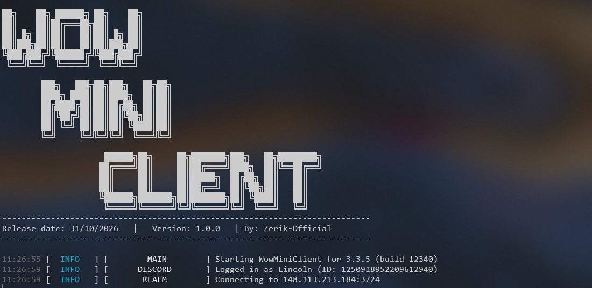

<h1 align="center">
  WowMiniClient
</h1>

<p align="center">
  
  
  
  
  
  
  
  
  
  
</p>

<p align="center">
  
</p>

<p align="center">
  <a href="./README.es.md">Español</a> | <strong>English</strong>
</p>

WowMiniClient is a lightweight, headless World of Warcraft client written in Python. It logs a character into a private server without the game client and relays chat between WoW and Discord: guild, officer, whispers, custom channels and more, plus guild events, dot commands and GM commands run from a Discord channel.

## Features

| Feature | Description |
| --- | --- |
| Chat relay | Two-way relay between WoW chats (guild, officer, say, yell, whisper, party, raid, custom channels...) and Discord channels, with custom formats and regex filters |
| Guild events | Online, offline, joins, leaves, kicks, promotions, demotions, MOTD and achievements posted to Discord |
| Dot commands | `.who`, `.gmotd` and `.r` (whisper reply) from Discord |
| GM commands | Run server commands from a Discord channel restricted by role, with a blocklist |
| Multiple expansions | Vanilla (1.6 to 1.12), TBC 2.4.3, WotLK 3.3.x, Cataclysm 4.3.4 and MoP 5.4.8 |
| Setup wizard | Console (InquirerPy) or temporary local web page (Flask) to create `wowchat.toml` |

See the [technical documentation](docs/README.md) for details.

## Repository structure

```
WowMiniClient/
├── src/
│   ├── main.py                # Client entry point
│   ├── configure.py           # Setup wizard entry point
│   ├── configurator/          # Console and web setup flows
│   ├── common/                # Config parsing, types, routing
│   ├── crypto/                # SRP6, RC4 and header encryption
│   ├── realm/                 # Realm (logon) server connection
│   ├── game/                  # Game server connection and packet handlers
│   ├── warden/                # Warden anti-cheat handling
│   ├── modules/bot/           # Discord bot
│   ├── utils/                 # Logger, banner and helpers
│   └── data/                  # Area and achievement names
├── tests/
├── docs/
│   ├── en/                    # English documentation
│   └── es/                    # Spanish documentation
├── wowchat.example.toml
├── pyproject.toml
└── requirements.txt
```

## Requirements

- Python 3.12+
- A Discord bot with the Message Content intent enabled
- A WoW account and character on the target server

## Getting started

The [getting started guide](docs/en/getting-started.md) covers the Discord bot, every configuration option and running the client. Quick start:

1. Create a virtual environment and install the dependencies:

   ```bash
   python -m venv venv
   source venv/bin/activate
   pip install -r requirements.txt
   ```

   On Windows PowerShell, activate it with `venv\Scripts\Activate.ps1`.

2. Run the setup wizard and choose the console or the browser:

   ```bash
   python src/configure.py
   ```

   It writes `wowchat.toml` in the project root, which is ignored by Git. You can also copy `wowchat.example.toml` and edit it by hand.

3. Start the client:

   ```bash
   python src/main.py
   ```

## Tests

```bash
pip install -e ".[dev]"
pytest
```
