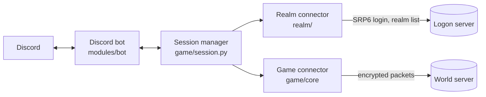
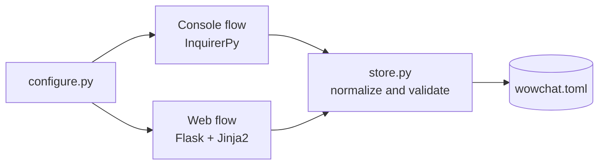

# Architecture

## Components

| Component | Folder | Responsibility |
| --- | --- | --- |
| Entry point | `src/main.py` | Loads the configuration, builds the routing maps and runs the bot and the session together |
| Configuration | `src/common/` | Parses `wowchat.toml` into typed dataclasses and builds the WoW and Discord routing maps |
| Realm connector | `src/realm/` | Authenticates against the logon server with SRP6 and picks the realm |
| Game connector | `src/game/` | Connects to the world server, encrypts headers, enters the world and decodes packets per expansion |
| Warden | `src/warden/` | Answers the server anti-cheat requests |
| Crypto | `src/crypto/` | SRP6, SHA1 based key derivation, RC4 and header ciphers |
| Discord bot | `src/modules/bot/` | Sends and receives relayed messages, dot commands and GM commands |
| Setup wizard | `src/configure.py`, `src/configurator/` | Console and web flows that write `wowchat.toml` |

## Connection flow

1. The realm connector logs in with the account, receives the session key and the realm list, and selects the configured realm.
2. The game connector opens the world server connection, authenticates with the session key and enters the world with the configured character.
3. Packet handlers are chosen by expansion (`vanilla`, `tbc`, `wotlk`, `cata`, `mop`); each one inherits the previous one and overrides what changed.
4. Chat, guild and system packets are routed to Discord channels through the maps built from `[[chat.channels]]` and `[guild.*]`.
5. If the game connection drops, the session manager reconnects with an increasing delay; the Discord bot retries every 10 seconds.

## Setup wizard

- `schema.py` holds the option lists, defaults and normalization shared by both flows.
- `store.py` merges the result with the sections it does not manage, validates it with `common.config.load_config` and writes it with `tomli-w`.
- The web flow listens only on `127.0.0.1`, uses a random port and requires a random key on every request. The page uses Tailwind CSS and Font Awesome from their CDNs.
