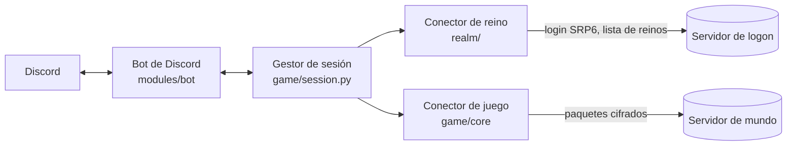
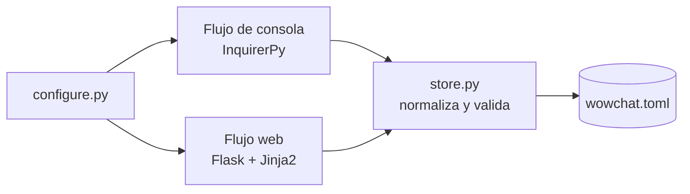

# Arquitectura

## Componentes

| Componente | Carpeta | Responsabilidad |
| --- | --- | --- |
| Punto de entrada | `src/main.py` | Carga la configuración, construye los mapas de enrutado y ejecuta el bot y la sesión juntos |
| Configuración | `src/common/` | Convierte `wowchat.toml` en dataclasses tipadas y construye los mapas de enrutado entre WoW y Discord |
| Conector de reino | `src/realm/` | Se autentica contra el servidor de logon con SRP6 y elige el reino |
| Conector de juego | `src/game/` | Conecta con el servidor de mundo, cifra las cabeceras, entra al mundo y decodifica paquetes por expansión |
| Warden | `src/warden/` | Responde a las peticiones del anti-trampas del servidor |
| Criptografía | `src/crypto/` | SRP6, derivación de claves con SHA1, RC4 y cifrado de cabeceras |
| Bot de Discord | `src/modules/bot/` | Envía y recibe los mensajes retransmitidos, los comandos con punto y los comandos de GM |
| Asistente de configuración | `src/configure.py`, `src/configurator/` | Flujos por consola y web que escriben `wowchat.toml` |

## Flujo de conexión

1. El conector de reino inicia sesión con la cuenta, recibe la clave de sesión y la lista de reinos, y selecciona el reino configurado.
2. El conector de juego abre la conexión con el servidor de mundo, se autentica con la clave de sesión y entra al mundo con el personaje configurado.
3. Los manejadores de paquetes se eligen según la expansión (`vanilla`, `tbc`, `wotlk`, `cata`, `mop`); cada uno hereda del anterior y sobrescribe lo que cambió.
4. Los paquetes de chat, hermandad y sistema se envían a los canales de Discord mediante los mapas construidos a partir de `[[chat.channels]]` y `[guild.*]`.
5. Si la conexión con el juego se cae, el gestor de sesión se reconecta con un retardo creciente; el bot de Discord reintenta cada 10 segundos.

## Asistente de configuración

- `schema.py` contiene las listas de opciones, los valores por defecto y la normalización que comparten ambos flujos.
- `store.py` combina el resultado con las secciones que no gestiona, lo valida con `common.config.load_config` y lo escribe con `tomli-w`.
- El flujo web solo escucha en `127.0.0.1`, usa un puerto aleatorio y exige una clave aleatoria en cada petición. La página usa Tailwind CSS y Font Awesome desde sus CDN.
